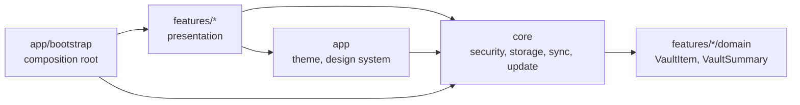

# AGENTS.md

Operating manual for humans and agents working on this repository. It answers
four questions: how do I build and verify it, what conventions do I follow,
where does the code live, and what must not break.

- **What the app is and why:** [README.md](README.md)
- **How the code is put together:** [ARCHITECTURE.md](ARCHITECTURE.md)
- **How a change is reviewed and merged:** [CONTRIBUTING.md](CONTRIBUTING.md)
- **How a vulnerability is reported:** [SECURITY.md](SECURITY.md)

## 1. Toolchain

| Tool | Version | Where it is pinned |
| --- | --- | --- |
| Flutter | 3.47.7 | [`mise.toml`](mise.toml) |
| Dart SDK | `^3.11.3` | [`pubspec.yaml`](pubspec.yaml) |
| Node | 24 (CI) | [`.github/workflows/flutter-ci.yml`](.github/workflows/flutter-ci.yml) — only for `commitlint` and `lefthook` |

```bash
mise install        # installs the pinned Flutter
flutter pub get     # resolve dependencies
```

Do not upgrade the Flutter version without opening an issue: the Dart SDK
constraint, the `local_auth_windows` toolchain note in CI and the release
toolchain all move together.

## 2. Commands

### Verify a change

```bash
flutter analyze                    # lints; must report "No issues found!"
flutter test                       # the whole suite
dart format --output=none --set-exit-if-changed lib test
```

### The coverage gate (CI runs it on every pull request)

```bash
flutter test --coverage
bash scripts/check_coverage.sh coverage/lcov.info lib/core/security 60
```

The threshold is **60 %** on `lib/core/security`. It is the CI floor for the
security core; lowering it to make a pull request pass is not a fix.

### Run the app

```bash
flutter devices                    # list the targets
flutter run -d windows             # desktop build
flutter run -d <android-id>        # Android build
```

### Build

```bash
flutter build apk --release
flutter build windows --release
```

The Windows build produces `build/windows/x64/runner/Release/gestor_contrasenas.exe`;
the published bundle renames it to `vaulta.exe`. Android release signing needs
secrets that are not in the repository — see
[docs/how-to/android-release-signing.md](docs/how-to/android-release-signing.md).

### Git hooks (Conventional Commits, format, lint)

```bash
npm install            # once per clone
npm run hooks:install  # lefthook -> pre-commit and commit-msg
```

`pre-commit` checks that the staged Dart files are formatted and analyze
cleanly. `commit-msg` runs `commitlint` with the same rules CI applies to the
pull request title.

### Everything CI runs

```bash
flutter pub get
flutter analyze
flutter test
flutter test --coverage
bash scripts/check_coverage.sh coverage/lcov.info lib/core/security 60
flutter build windows --release     # smoke test, pull requests only
```

Pull requests that touch `supabase/migrations/` also run
[`.github/workflows/supabase-migrations-ci.yml`](.github/workflows/supabase-migrations-ci.yml),
which applies the migrations against a real Postgres instance.

## 3. Where the code lives

```
lib/
  main.dart                  process entry point
  app/
    bootstrap/                THE composition root: builds every concrete service
    design_system/            reusable Material 3 widgets
    theme/                    colors, spacing, themes
    localization/             locale preference and controller
  core/
    security/                 master password, Argon2id, AES-256-GCM, biometrics,
                              secure storage, clipboard, backup, VaultRepository,
                              VaultSecurityController
    storage/                  encrypted SQLite: repository, schema, opener,
                              blob->database migration
    sync/                     optional Supabase sync: devices, conflicts, vault key
    update/                   in-app release check and signature verification
  features/
    vault/        backup/     health/      totp/       access/
    autofill/     security/   settings/    sync/       home/
    └── each one: domain/ · application/ · data/ · presentation/
  l10n/                       generated from app_*.arb
android/app/src/main/kotlin/  KeyStore, BiometricPrompt, clipboard, update, autofill
windows/ linux/ macos/ ios/ web/   Flutter runner shells (only Windows ships)
supabase/migrations/          optional backend schema, RPCs and RLS
test/                         73 unit and widget test files
integration_test/             4 on-device tests
docs/                         Diátaxis documentation (tutorials, how-to, reference, explanation, adr)
```

Look in this order when you need to change something: the feature that owns
the behavior → `lib/core` if it is shared → `lib/app/bootstrap` if a new
implementation has to be wired.

## 4. Architecture in brief

Full detail, with the module map and the boundary rules, is in
[ARCHITECTURE.md](ARCHITECTURE.md). The five things to know:

1. **One composition root.** `lib/app/bootstrap/password_manager_app.dart`
   builds every concrete service once and mounts the widget tree. Screens
   receive their collaborators; they never construct them.
2. **`lib/core` is the part that must be right:** crypto, key storage, the
   unlock path, the on-device storage and the optional sync.
3. **`lib/features` is layered downward:** `presentation → application →
   domain`. `domain` owns the model (`VaultItem`, `VaultSummary`) that `core`
   and the other features speak.
4. **Everything optional degrades instead of branching.** No Supabase
   defines → no sync. No `VAULTA_SQLITE_STORAGE` → the encrypted blob. Not
   Android → no biometrics, no autofill. The branch lives in one place per
   platform decision, not at every call site.
5. **The vault is only read through `VaultRepository`** (and, for autofill,
   through the one-question `AutofillVaultLookup` port).



## 5. Conventions

### Language

- **Code, code comments, doc comments, identifiers, commit messages and
  repository documentation are written in English.** This includes
  `README.md`, `ARCHITECTURE.md`, `AGENTS.md` and everything under `docs/`.
- The **user-facing strings** are localized: add the key to
  `lib/l10n/app_en.arb` and `lib/l10n/app_es.arb`, then run
  `flutter gen-l10n`. The Dart files in `lib/l10n/` are generated — never
  hand-edit them.
- Conversation with a human is in their language; the artifacts stay in
  English.

### Commits and pull requests

- [Conventional Commits 1.0.0](https://conventionalcommits.org/en/v1.0.0/):
  `<type>(<scope>): <description>`. The type list is closed: `feat`, `fix`,
  `docs`, `style`, `refactor`, `perf`, `test`, `build`, `ci`, `chore`,
  `revert`. The scope is kebab-case. The subject has no trailing period and
  is not in Title Case. The header is at most 120 characters.
- The **pull request title** is the Conventional Commit subject, because the
  merge into `master` is a squash merge and the title is the commit that
  lands.
- One commit does one thing. Tests and docs for a change travel in the same
  commit as the change.
- Aim for **400 changed lines or fewer** per pull request; split anything
  larger into a chain.
- `release-please` reads the commits to compute the version and write
  `CHANGELOG.md`. A commit that breaks the convention is invisible to the
  release automation.

### Code

- `public_member_api_docs` is a warning on the whole `lib/` tree: every
  public member needs a doc comment that says what it does, not what it is.
- The extra lints (`prefer_const_constructors`, `prefer_const_declarations`,
  `unawaited_futures`, `avoid_dynamic_calls`) are on. Do not relax a rule in
  `analysis_options.yaml` to make a build pass.
- `// ignore_for_file:` is grandfathered debt. New code in a suppressed file
  must satisfy the rule, and a new suppression needs a justification in an
  adjacent comment.
- Formatting is `dart format`; the pre-commit hook fails on unformatted staged
  files.
- Prefer an explicit type over `dynamic`. Prefer a sealed type over a
  platform check scattered across the tree.

### Tests

- New behavior gets a test. The suite is `flutter test`; the path of a test
  mirrors the path of the code it covers (`test/core/security/…` for
  `lib/core/security/…`).
- A test asserts the observable effect through the public interface: the
  return value, the thrown error, the state left behind.
- `test/` runs headless on the CI. `integration_test/` needs a real device
  or emulator and is not part of the default run.
- `scripts/publication_screenshots_test.dart` is a golden test: it compares
  the publication screenshots against the current UI. If a visual change is
  intended, regenerate the PNGs in `docs/publication/screenshots/` in the
  same pull request.

### Documentation

- `docs/` is Diátaxis: `tutorials/` (learn by doing), `how-to/` (do a task),
  `reference/` (look up a fact), `explanation/` (understand why), `adr/`
  (why a decision was made). One question per document; see
  [docs/README.md](docs/README.md).
- **Architectural decisions are ADRs**, numbered and append-only, in
  `docs/adr/`. A decision that turned out to be wrong is superseded by a new
  ADR, never edited in place.
- A change in behavior updates the documentation that describes it in the same
  pull request — including
  [docs/reference/security-hardening-status.md](docs/reference/security-hardening-status.md)
  when a security control changes.
- Diagrams are **Mermaid inside Markdown**, never images. A diagram that
  cannot be reviewed in a diff is a diagram that goes stale.

### Naming

The product is **Vaulta**. The Dart package is still `gestor_contrasenas` and
the Android application id is `com.insyd.gestor_contrasenas`; both are
historical and are not being renamed. The Android method channels use
`com.insyd.vaulta/*`, except the autofill channel, which keeps
`com.insyd.gestor_contrasenas/autofill` — the app's package name at the time.
Each channel name exists exactly once in Dart and once in Kotlin, so renaming
one is a two-file change that has to land together.

## 6. Definition of done

- [ ] `flutter analyze` reports no issues.
- [ ] `flutter test` passes, and the new behavior has a test.
- [ ] The coverage gate passes if `lib/core/security` changed.
- [ ] `dart format` has been run on the changed files.
- [ ] The documentation that describes the behavior changed with it.
- [ ] The pull request body follows
      [`.github/pull_request_template.md`](.github/pull_request_template.md),
      and its **Evidence** section states the commands that were run and what
      they printed.
- [ ] The version in `pubspec.yaml` is bumped if the change ships behavior.
- [ ] No secrets, real vault data or signing material are in the diff.

## 7. Rules that are not negotiable

1. **Never weaken a security control silently.** A change to cryptography, key
   storage, unlock protection, data leakage paths, sync authentication or the
   updater gets a focused review: name the threat, and include the evidence
   that the control still holds (the test vector, the refusal path, the
   threat-model entry).
2. **Never report a vulnerability through a pull request.** Use
   [SECURITY.md](SECURITY.md).
3. **Never add telemetry.** There is no analytics dependency, and adding one
   changes the threat model.
4. **Never make a published build depend on the network.** Sync is opt-in;
   the default install works offline.
5. **Never commit signing material, real vault contents or a master
   password.**
6. **Never relax a lint or lower the coverage threshold** to make a pull
   request pass.

## 8. Where to look for specific things

| I want to… | Look at |
| --- | --- |
| Change how the vault is encrypted | `lib/core/security/master_password_service.dart`, `lib/core/security/aes_gcm_vault_crypto_service.dart`, [ADR-0001](docs/adr/0001-crypto-key-derivation-and-encrypted-blob.md) |
| Change how the vault is stored | `lib/core/storage/` (SQLite) and `lib/core/security/local_encrypted_vault_repository.dart` (blob), [ADR-0007](docs/adr/0007-encrypted-local-database.md) |
| Change the unlock flow or the lock gate | `lib/core/security/vault_security_controller.dart`, `lib/features/security/presentation/security_gate.dart` |
| Change the Android biometrics | `android/app/src/main/kotlin/.../BiometricChannel.kt`, `KeystoreChannel.kt`, `lib/core/security/native_biometric_auth_service.dart` |
| Change autofill | `android/app/src/main/kotlin/.../autofill/`, `lib/features/autofill/`, [ADR-0008](docs/adr/0008-android-autofill.md) |
| Change sync | `lib/core/sync/`, `supabase/migrations/`, [ADR-0002](docs/adr/0002-sync-versioning-cas-idempotency-tombstones.md) |
| Change import or export | `lib/features/vault/application/vault_import_parser.dart`, `lib/features/backup/` |
| Add a user-facing string | `lib/l10n/app_en.arb`, `lib/l10n/app_es.arb`, then `flutter gen-l10n` |
| Add a screen | A new `lib/features/<name>/presentation/`, mounted from `lib/features/home/presentation/app_shell.dart` |
| Change the release process | `docs/how-to/release-process.md`, `.github/workflows/release.yml` |
| Change the in-app updater | `lib/core/update/update_service.dart`, `android/app/src/main/kotlin/.../UpdateChannel.kt` |
