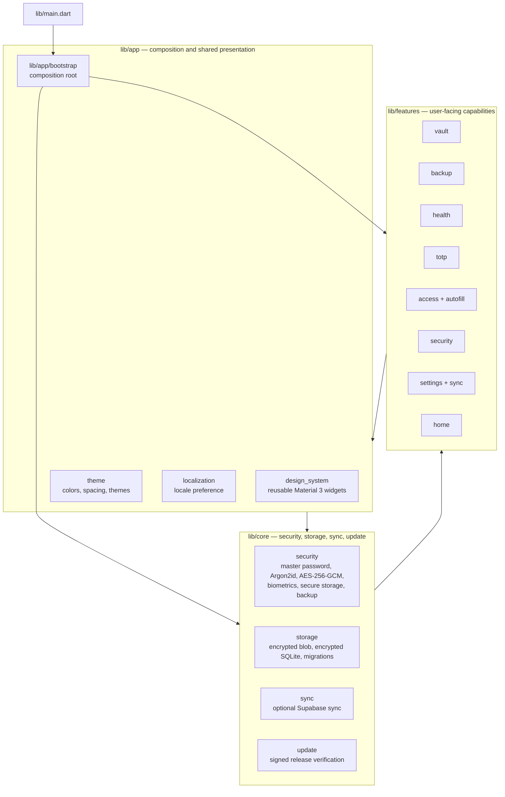
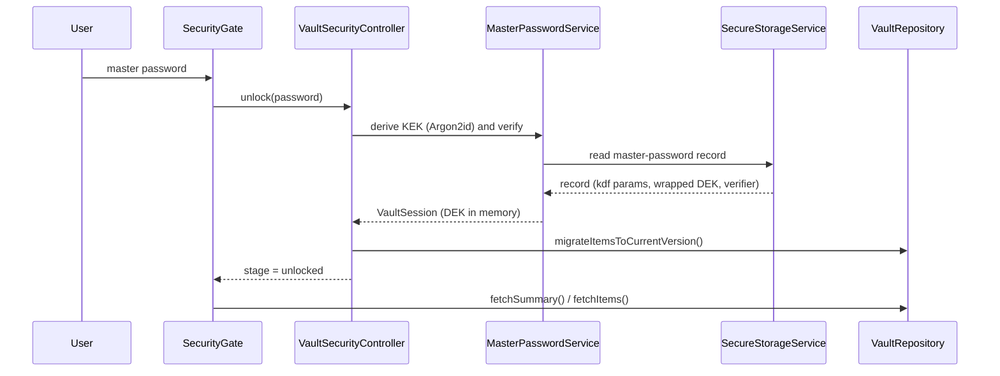

# Architecture

This document is the map of Vaulta's code: what each module owns, which
directions the dependencies are allowed to point, and what must not change
without an ADR.

It is the *shape* of the system, not its behaviour. For the behaviour, read the
documents that answer a specific question:

| Question | Document |
| --- | --- |
| Why is it built this way? | [docs/adr/](docs/adr/README.md) — numbered decisions |
| How is the data encrypted? | [docs/reference/crypto-architecture.md](docs/reference/crypto-architecture.md) |
| What does each security control do today? | [docs/reference/security-hardening-status.md](docs/reference/security-hardening-status.md) |
| What can an attacker do? | [docs/explanation/threat-model.md](docs/explanation/threat-model.md) |
| How do I build, test and change it? | [AGENTS.md](AGENTS.md) |

**Where this document and the code disagree, the code wins.** If you change the
code, change this document in the same pull request.

## 1. The system at a glance

Vaulta is a single Flutter application. Its four `lib/` trees have distinct
jobs, and the arrows below are the actual import directions in the tree today
(not an aspiration).

Two things in that graph are worth stating plainly, because they look like
mistakes and are not:

- **`lib/app` and `lib/features` depend on each other.** `lib/app/bootstrap` is
  the composition root, so it imports the screens it mounts, and
  `lib/app/design_system/vault_entry_tile.dart` imports the `VaultItem` type it
  renders. The other direction — features importing `lib/app/theme`,
  `lib/app/design_system` and `lib/app/localization` for the shared UI — is the
  bulk of the traffic. The cycle is closed by keeping the composition in
  `lib/app/bootstrap` and by keeping the one app→feature import a *type*,
  never behavior.
- **`lib/core` imports `lib/features/vault/domain`.** Only the *types*
  (`VaultItem`, `VaultSummary`), never a screen. The item model is the one
  vocabulary every layer speaks, and it lives with the feature that owns it.

## 2. Module map

### `lib/app` — composition and shared presentation

| Path | Owns | May depend on |
| --- | --- | --- |
| `lib/main.dart` | The process entry point. Nothing else. | `lib/app/bootstrap` |
| `lib/app/bootstrap/` | **The composition root.** Builds every concrete service exactly once and mounts the widget tree. | `lib/core/*`, `lib/features/*` |
| `lib/app/design_system/` | Reusable widgets (`app_components`, `app_panel`, `metric_card`, `vault_entry_tile`). | `lib/app/theme`, `lib/l10n`, item *types* |
| `lib/app/theme/` | Colors, spacing and the Material 3 themes. | Flutter only |
| `lib/app/localization/` | The locale preference and its controller. | `lib/l10n`, `core/security` (secure storage) |

### `lib/core` — the parts that must be right

| Path | Owns | Talks to |
| --- | --- | --- |
| `lib/core/security/` | Master password and KDF, AES-256-GCM, the DEK and its envelope, biometrics, secure storage, clipboard, password policy, vault backup, the encrypted-blob repository, `VaultRepository` (the read/write port) and `VaultSecurityController` (the lock state). | Platform channels, `lib/core/storage`, `lib/core/sync` |
| `lib/core/storage/` | The encrypted SQLite database: the repository, the schema, the opener, the salt store and the blob→database migration. | `lib/core/security`, `lib/core/sync` |
| `lib/core/sync/` | The optional sync layer: device registration and revocation, the bidirectional sync service, conflict resolution, the vault-key sync and the Supabase implementations. | `lib/core/security`, Supabase |
| `lib/core/update/` | The in-app update check: release channel, download and signature verification. | `lib/core/security` (secure storage), GitHub Releases |

### `lib/features` — user-facing capabilities

Each feature owns its own layers, named by role:

| Layer | Responsibility | May import |
| --- | --- | --- |
| `presentation/` | Widgets, dialogs and screens. | `application/`, `domain/`, `lib/app`, `lib/core` |
| `application/` | Use cases and orchestration (import, backup, health report, merge). | `domain/`, `lib/core` |
| `domain/` | The model and the rules. It may use Flutter types (`Color`, `IconData`) but never a screen, a controller or a service. | other features' `domain/` types |
| `data/` | Implementations of ports (file gateways). | `domain/`, `lib/core` |

| Feature | Capability |
| --- | --- |
| `vault` | Dashboard, search, detail, editor, import, favorites, password history, the `VaultItem` model |
| `backup` | Encrypted `.vaulta` backup and restore, clear-text export, merge |
| `health` | Weak and reused secret report, security score copy |
| `totp` | Base32, `otpauth://` URIs and RFC 6238 codes |
| `access` | The "Access" tab: autofill service status and unlock posture |
| `autofill` | The Dart side of the Android autofill service: channel and candidate matching |
| `security` | The lock gate, the unlock screen, the capability panel |
| `settings` | Preferences, biometrics, sync, updates |
| `sync` | Sign-in, conflicts, the sync gate |
| `home` | The unlocked shell and the bottom navigation |

### Outside `lib/`

| Path | Owns |
| --- | --- |
| `android/app/src/main/kotlin/` | The native side: KeyStore, `BiometricPrompt`, clipboard, update channel, autofill service. |
| `windows/`, `linux/`, `macos/`, `ios/`, `web/` | Flutter runner shells. Only Windows is a release target. |
| `supabase/migrations/` | The optional backend schema, RPCs and RLS policies. |
| `test/`, `integration_test/` | The unit/widget tests and the on-device tests. |

## 3. The rules that hold

**R1 — One composition root.** Concrete implementations are instantiated in
`lib/app/bootstrap/password_manager_app.dart` and nowhere else. A screen never
constructs a repository, a crypto service or a platform channel; it receives
them. If you need a new implementation, wire it in the bootstrap and inject it.

**R2 — `lib/core` never imports a screen.** `lib/core` may import
`lib/features/*/domain` types, never `presentation`, `application` or `data`.
That is why the vault model lives in `lib/features/vault/domain`: it is the
one type both sides need.

**R3 — Features layer downward only.** `presentation → application → domain`.
`domain` never imports `application` or `presentation`. `data` implements ports
declared by `domain` or `application`, never the other way around.

**R4 — Cross-feature imports are types and navigation, not behaviour.** The
observed cross-feature edges are: `vault → health`, `vault → totp`,
`vault → sync`, `backup → vault`, `backup → security`, `health → vault`,
`home → access/settings/vault`, `settings → backup/security`,
`autofill → vault`. Every one of them is a widget mount or a domain type. A
feature that needs another feature's *behaviour* is a signal to move that
behaviour into `lib/core` or into `lib/features/<owner>/domain`.

**R5 — A platform branch lives in exactly one place.** The biometric stack is
resolved by `resolveBiometricStack()` in the bootstrap, as a sealed
`BiometricStack` with one case per platform family, because two independent
`defaultTargetPlatform` branches once paired the KeyStore provider with the
self-prompting `local_auth` gate and produced two prompts per unlock. The same
rule applies to storage (`vaultSqliteStorageEnabled`), to sync
(`SUPABASE_URL` / `SUPABASE_ANON_KEY`) and to the update channel.

**R6 — The vault is read through the repository.** `VaultRepository` is the
read/write port. Autofill does not get a repository: it gets
`AutofillVaultLookup`, a one-question port (`findByHost`) that the SQLite
implementation answers from the `vault_hosts` index and the blob
implementation answers from a scan. The handler cannot accidentally read the
whole vault (ADR-0008 §3, §5).

**R7 — The sync layer is opt-in and absent by default.**
`SyncSignInGate` reads the two compile-time defines: with no `SUPABASE_URL` and
`SUPABASE_ANON_KEY` it renders its child immediately and never contacts
Supabase. `buildDeviceSyncLifecycle()` returns `null` in the same case, so the
lifecycle-dependent widgets receive a null resolver and the optional-sync UI is
simply not there. The published builds define neither, so sync never runs.

## 4. Runtime flows

### 4.1 Unlock

The DEK exists only in the in-memory `VaultSession`. The record on disk holds
the KDF parameters, the wrapped DEK and the verifier — never the DEK itself.

### 4.2 Storage: two implementations, one flag

| | Encrypted blob (default) | Encrypted SQLite (`VAULTA_SQLITE_STORAGE=true`) |
| --- | --- | --- |
| Implementation | `core/security/local_encrypted_vault_repository.dart` | `core/storage/sqlite_vault_repository.dart`, opened lazily by `lazy_sqlite_vault_repository.dart` |
| Shape | One encrypted blob holding every item | One encrypted database with tables and a `vault_hosts` index |
| Encryption | AES-256-GCM over the serialized payload | SQLite3 Multiple Ciphers (sqlite3mc), compiled as a native asset |
| Host lookup | Full scan | Indexed `vault_hosts` query |
| Status | The default in every published build | Wired and tested, **off** by default |

Both implement `VaultRepository`, so the flag only changes the storage
mechanism, the rekey hook and the payload-upgrade hook. Turning it on for a
release is an owner decision that requires the verification plan in
[ADR-0007](docs/adr/0007-encrypted-local-database.md): take an encrypted
`.vaulta` backup first, then run on a real device.

The `sqlite3` native-asset hook in `pubspec.yaml`
(`hooks.user_defines.sqlite3.source = sqlite3mc`) is what keeps the database
file encrypted at rest. Removing it silently writes the vault in the clear.

### 4.3 Sync (optional)

Sync is a second device for the same vault, not a requirement for one. When
enabled: the wrapped DEK travels in `vault_keys` under RLS, guarded by
`rpc_vault_get_key` / `rpc_vault_put_key`; a second device with the same
master password reconstructs the same DEK. The pull path applies remote
snapshots through `RemoteSnapshotApplier`, and the local mutation sink drains
local writes into the push queue.

### 4.4 Autofill

The Android `AutofillService` runs in the app's own process and calls one
`MethodChannel` on the app's single Flutter engine — there is no second
engine, no second Dart heap and therefore no cache to keep in sync with the
session. The channel answers `locked`, `matched` or `searchOnly`; it never
logs a candidate.

## 5. The platform boundary

Everything that crosses into native code goes through a named `MethodChannel`.
Each name exists exactly once in Dart and once in Kotlin.

| Channel | Dart side | Kotlin side | Carries |
| --- | --- | --- | --- |
| `com.insyd.vaulta/keystore` | `core/security/android_keystore_envelope_key_provider.dart` | `KeystoreChannel.kt` | Envelope key mint and release |
| `com.insyd.vaulta/biometric` | `core/security/native_biometric_auth_service.dart` | `BiometricChannel.kt` | `BiometricPrompt` with a `CryptoObject` |
| `com.insyd.vaulta/clipboard` | `core/security/sensitive_clipboard_service.dart` | `ClipboardChannel.kt`, `ClipboardClearReceiver.kt` | Copy and timed wipe |
| `com.insyd.vaulta/update` | `core/update/update_service.dart` | `UpdateChannel.kt` | Release channel, download, signature |
| `com.insyd.gestor_contrasenas/autofill` | `features/autofill/autofill_channel.dart` | `autofill/VaultaAutofillBridge.kt` | Autofill queries |

The autofill channel keeps its original `gestor_contrasenas` prefix — the app's
package name at the time — while the other four use `com.insyd.vaulta`. The
name exists exactly once in Dart and once in Kotlin, so renaming it is a
two-file change that has to land together.

## 6. What not to touch

| Thing | Why |
| --- | --- |
| **The cryptographic parameters**: Argon2id (64 MiB, 3 iterations, parallelism 1), the HKDF-SHA256 split of the 64-byte output, AES-256-GCM, the DEK envelope, the payload versions and their AAD binding. | They are the contract in [ADR-0001](docs/adr/0001-crypto-key-derivation-and-encrypted-blob.md) and in the [crypto reference](docs/reference/crypto-architecture.md). Changing one is a format change, not a refactor. |
| **The `sqlite3` native-asset hook** in `pubspec.yaml`. | It is what encrypts the SQLite file. Removing it writes the vault in the clear. |
| **The lint rules** in `analysis_options.yaml`, especially `public_member_api_docs`. | They are enforced on purpose ([ADR-0005](docs/adr/0005-repository-hygiene-lints-and-coverage.md)). Do not relax a rule to make CI green. |
| **The `// ignore_for_file:` suppressions.** | They are grandfathered debt. New code in a suppressed file must satisfy the rule; a new suppression needs a justification in an adjacent comment. |
| **`lib/l10n/app_localizations*.dart`.** | Generated from `lib/l10n/app_*.arb` by `flutter gen-l10n` (running it produces no diff today). Edit the `.arb` files and regenerate. |
| **The coverage gate** (`scripts/check_coverage.sh … lib/core/security 60`). | It is the CI floor for the security core. |
| **`pubspec.lock`.** | A dependency bump needs a stated reason and a green CI run ([CONTRIBUTING.md](CONTRIBUTING.md)). |
| **The composition root's structure.** | The bootstrap is long on purpose: one file that shows every concrete dependency of the app, in order. Splitting it hides the wiring. |
| **Anything that weakens a security control** without a threat-model entry. | Say so in the pull request, with the evidence that the control still holds. |

## 7. The decisions behind this shape

| # | Decision | Status |
| --- | --- | --- |
| [0001](docs/adr/0001-crypto-key-derivation-and-encrypted-blob.md) | Key derivation and encrypted blob format v2 | Accepted |
| [0002](docs/adr/0002-sync-versioning-cas-idempotency-tombstones.md) | Sync model with versioning, CAS, idempotency and tombstones | Accepted |
| [0003](docs/adr/0003-session-policy-and-revocation.md) | Session policy and per-device / global revocation | Accepted |
| [0004](docs/adr/0004-sync-layer-roadmap.md) | Roadmap for the `lib/core/sync/` layer | Accepted |
| [0005](docs/adr/0005-repository-hygiene-lints-and-coverage.md) | Repository hygiene, lints and coverage | Accepted |
| [0006](docs/adr/0006-encrypted-backup-format.md) | Encrypted backup format (`.vaulta`) and export/restore flow | Accepted |
| [0007](docs/adr/0007-encrypted-local-database.md) | Local storage moves from one encrypted blob to an encrypted database | Accepted |
| [0008](docs/adr/0008-android-autofill.md) | Android autofill service | Proposed |

## 8. Checking a change against this document

After a change that touches the shape of the system, verify:

1. `flutter analyze` is clean — the lints are the first line of defence.
2. `flutter test` passes, and the new behavior has a test that pins it.
3. If a boundary moved, this document and the ADR (if any) say so in the same
   pull request.
4. If a platform channel changed, the Dart name and the Kotlin name changed
   together.
5. The evidence in the pull request says which commands were run and what they
   printed. "Should work" is not evidence.
