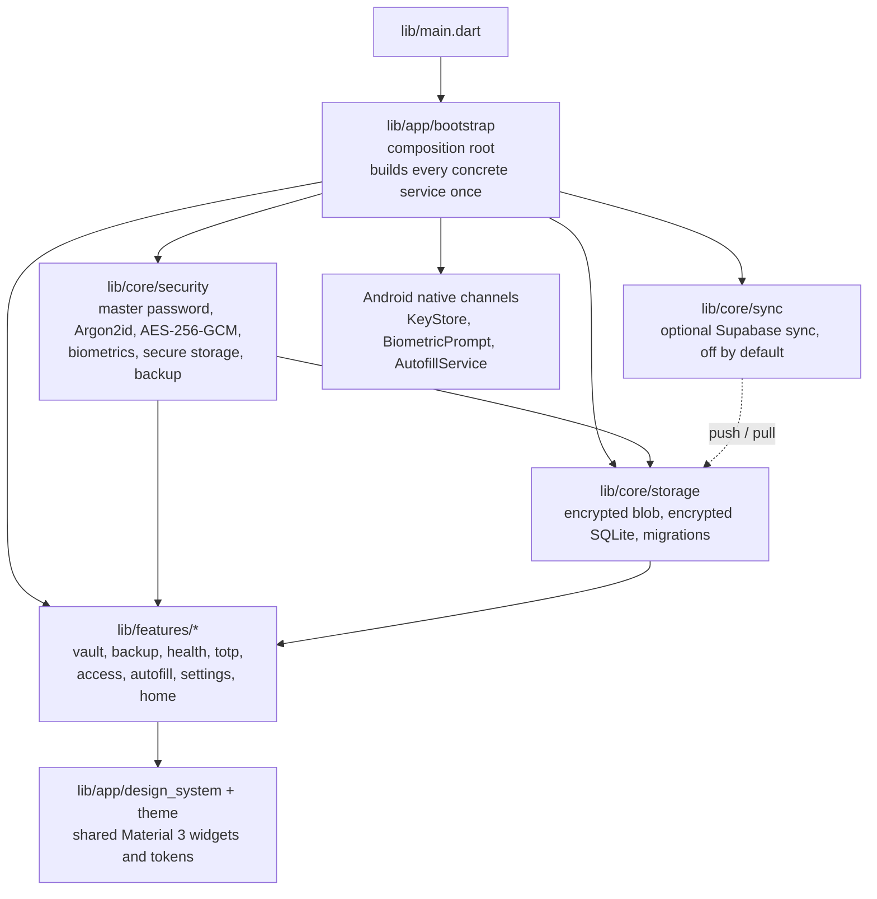

<p align="center">
  
</p>

<h1 align="center">Vaulta</h1>

<p align="center">
  <strong>Offline-first, encrypted password manager for Android and Windows desktop.</strong>
</p>

<p align="center">
  <a href="https://github.com/Rene-Kuhm/vaulta/releases/latest/download/vaulta.apk">Download APK (Android)</a>
  ·
  <a href="https://github.com/Rene-Kuhm/vaulta/releases/latest/download/vaulta-windows-bundle.zip">Download Windows bundle</a>
  ·
  <a href="https://github.com/Rene-Kuhm/vaulta/releases/latest">Releases</a>
  ·
  <a href="https://www.tecnodespegue.com/">TecnoDespegue</a>
</p>

## What it does

- **Keeps your credentials in an encrypted local vault.** Every item is sealed
  with AES-256-GCM under a random per-vault data key (DEK); the DEK is wrapped
  by a key derived from your master password with Argon2id. The password is
  never stored, and the key material never leaves the device unless you turn
  sync on.
- **Unlocks with your master password everywhere, and with the Android
  Keystore on Android.** The biometric path releases the envelope key through a
  real `BiometricPrompt` bound to a `CryptoObject`, so the hardware refuses to
  hand over the key without the user's biometric.
- **Fills logins from the Android system autofill service.** The service
  answers only with entries indexed for the requesting app's host; when there
  is no match it offers a search inside Vaulta instead of guessing
  ([ADR-0008](docs/adr/0008-android-autofill.md)).
- **Manages TOTP codes (RFC 6238) next to the secret they belong to**, with a
  live countdown, and keeps a password history per entry so a rotated secret
  stays recoverable.
- **Moves data in and out safely:** import from CSV, JSON and KeePass (`.kdbx`
  3.1 and 4.x) with a preview before saving; export to CSV/JSON only behind an
  explicit warning and a re-authentication; encrypted `.vaulta` backup and
  restore with its own password.
- **Tells you how your vault is doing:** weak entries, reused secrets, a
  security score, and a health report where every finding opens the entry it
  refers to.
- **Fails closed:** auto-lock on backgrounding and after an idle timeout, a
  clipboard that wipes itself 30 seconds after a copy, an unlock attempt
  limiter, and explicit handling of revoked devices.
- **Updates itself from inside the app**, verifying the release it downloads
  on the stable channel and on the rolling `dev-latest` channel.

### Platform support

| | Android | Windows desktop |
| --- | --- | --- |
| Vault, search, TOTP, backup, health | ✅ | ✅ |
| Master-password unlock | ✅ | ✅ |
| Biometric unlock | ✅ (Android KeyStore + `BiometricPrompt`) | ❌ master password only |
| System autofill | ✅ | ❌ |
| In-app update channel | ✅ | ❌ |

iOS, macOS, Linux and web are **not** release targets: they carry the default
Flutter runner scaffolding and nothing else. There is no iOS Credential
Provider, no browser extension and no passkey support.

## Why it exists

Most password managers make you trust a server: the account is the product,
sync runs through somebody else's infrastructure, and the cryptography is
something you have to take on faith. Vaulta is built the other way around.

- **The vault is local first.** The full feature set works with no account and
  no network. Sync is an opt-in layer on top, disabled in every published
  build, so the default install has no server-side component at all.
- **The cryptography is auditable, not asserted.** Argon2id, AES-256-GCM,
  HKDF-SHA256, versioned payload formats and an explicit key hierarchy, all
  written down in [the crypto reference](docs/reference/crypto-architecture.md)
  with the source files and the open questions for an external auditor.
- **Decisions are recorded.** Every architectural decision is a numbered ADR
  with its context, its decision and its cost
  ([docs/adr/](docs/adr/README.md)), and the security controls have a status
  page with `file:line` evidence
  ([docs/reference/security-hardening-status.md](docs/reference/security-hardening-status.md)).
- **No tracking.** There is no analytics or telemetry dependency in
  `pubspec.yaml`; the app talks to nothing it was not configured to talk to.
- **Open development.** Real code, small pull requests, conventional commits
  and CI that runs the same checks you run locally.

Vaulta is an MVP and it says so: it has **not** been through an external
cryptographic audit, and it must not be presented as a certified security
product until that review exists.

### What is not available yet

- **No sync in the published builds.** The sync layer is implemented and
  tested, but the release pipeline defines neither `SUPABASE_URL` nor
  `SUPABASE_ANON_KEY`, so a published build never contacts a server.
- **No code signing on the Windows binary.** The published bundle is unsigned,
  so Windows SmartScreen asks for confirmation on the first run.
- **No external cryptographic audit.** See the note above.

## Architecture

Everything is wired in one place — `lib/app/bootstrap/password_manager_app.dart`
— and every concrete service is built there, once.



The full module map, the boundaries between layers and the rules that are not
negotiable live in **[ARCHITECTURE.md](ARCHITECTURE.md)**.

## Run it

Three commands, from a clean clone:

```bash
mise install        # Flutter 3.47.7, the version pinned in mise.toml
flutter pub get     # resolve dependencies
flutter run         # pick a device with: flutter devices
```

`flutter run -d windows` builds the desktop app; `flutter run -d <android-id>`
builds the Android app. The Android toolchain (Android Studio or the SDK) is
needed for Android builds, and Visual Studio 2022 Build Tools with the
**Desktop development with C++** workload for Windows builds.

## Screenshots

<table>
  <tr>
    <td width="25%"></td>
    <td width="25%"></td>
    <td width="25%"></td>
    <td width="25%"></td>
  </tr>
  <tr>
    <td align="center"><sub>Onboarding</sub></td>
    <td align="center"><sub>Dashboard</sub></td>
    <td align="center"><sub>Search</sub></td>
    <td align="center"><sub>Editor</sub></td>
  </tr>
  <tr>
    <td width="25%"></td>
    <td width="25%"></td>
    <td width="25%"></td>
    <td width="25%"></td>
  </tr>
  <tr>
    <td align="center"><sub>Detail</sub></td>
    <td align="center"><sub>Unlock</sub></td>
    <td align="center"><sub>Settings</sub></td>
    <td></td>
  </tr>
</table>

## Documentation

| You want to… | Start here |
| --- | --- |
| Understand how the code is put together | [ARCHITECTURE.md](ARCHITECTURE.md) |
| Build, test, lint, and follow the conventions | [AGENTS.md](AGENTS.md) |
| Learn Vaulta by doing it | [docs/tutorials/](docs/tutorials/) |
| Do one specific task | [docs/how-to/](docs/how-to/) |
| Look a fact up | [docs/reference/](docs/reference/) |
| Understand why it works this way | [docs/explanation/](docs/explanation/) |
| Know why a decision was made | [docs/adr/](docs/adr/README.md) |
| Contribute a change | [CONTRIBUTING.md](CONTRIBUTING.md) |
| Report a vulnerability | [SECURITY.md](SECURITY.md) |
| See what changed in each release | [CHANGELOG.md](CHANGELOG.md) |

## License

MIT (Copyright 2026 Rene Kuhm). See [`LICENSE`](./LICENSE).
